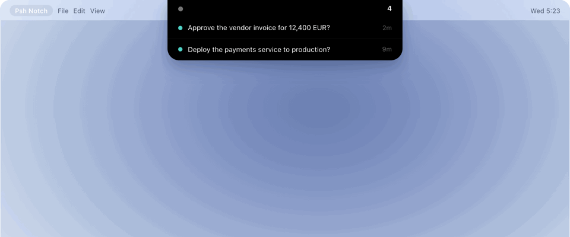

# psh.now skill



[](https://www.skills.sh/passy-ai/psh-now-skill)

Approve, deny, or answer an agent's questions from your phone, so it never stalls in a terminal
nobody is watching. This is the skill. The server behind it is
[passy-ai/psh-now](https://github.com/passy-ai/psh-now): open source, MIT, self hostable.

```bash
npx skills add passy-ai/psh-now-skill -g -y
```

Then `psh setup` in the folder you want watched, or `psh ask "rm -rf build"` before something
irreversible. Install details, the CLI and the HTTP API are in the
[main repository](https://github.com/passy-ai/psh-now).

MIT, Copyright (c) 2026 Absolum. See [LICENSE](LICENSE).
